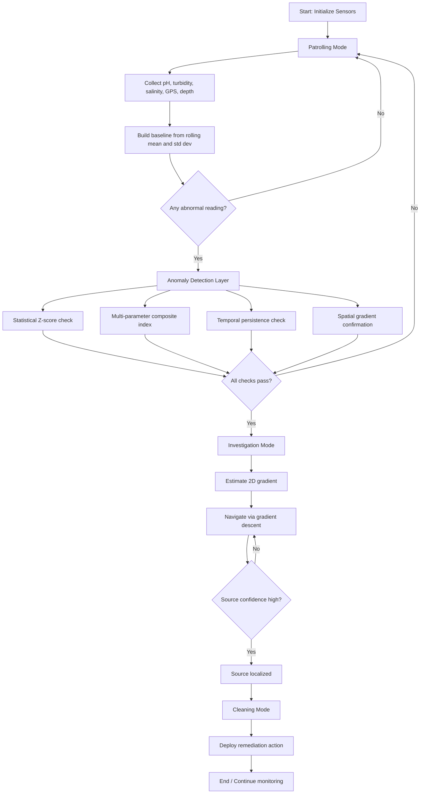

# Aquatic Robotic System Review and Simulation Plan

## Review Summary
The document describes an autonomous aquatic robot that:
- patrols a water body and collects baseline sensor data,
- detects anomalies using statistical and multi-parameter logic,
- confirms that the anomaly is meaningful using persistence and spatial gradient checks,
- switches into investigation mode to localize the contamination source,
- and finally enters cleaning mode for adaptive remediation.

The core idea is a layered decision pipeline:
1. Patrolling Mode
2. Anomaly Detection
3. Investigation and Source Localization
4. Cleaning Mode

## Mermaid Diagram


## Implementation Plan for a Simulation

### 1. Build the virtual environment
Create a 2D lake surface represented as a grid.
- Each cell stores values for:
  - pH
  - turbidity
  - salinity
  - temperature
- Add one or more contamination sources that create a gradient field.

### 1A. UI approach
Yes — I will build a lightweight UI so the simulation is interactive and easy to observe.
- A simple desktop UI using Tkinter is a good starting point because it requires no extra web setup.
- The UI will include:
  - Start / Pause / Stop controls
  - A live view of the robot path and contamination field
  - Panels for current sensor values and current mode
  - A log or history window for anomalies and actions

### 1B. Database approach with SQLite
I will use SQLite to store and persist simulation data.
- The database will keep the results of each run so they are not lost when the app closes.
- Suggested tables:
  - runs: simulation run metadata
  - samples: sensor readings over time
  - anomalies: detected anomaly events
  - remediation_events: cleanup actions and outcomes
- On startup, the app can reload the latest run and display historical data.

### 2. Model the robot
Represent the Aqua Bot as a stateful object with:
- current position,
- sensor readings,
- history of samples,
- current mode,
- energy level,
- confidence score.

### 3. Simulate sensing
For each time step:
- move the robot by a small step,
- read the environment at its current location,
- add Gaussian noise to simulate sensor error,
- store the result in a time-series buffer.

### 4. Implement Patrolling Mode
- the robot moves along a predefined or adaptive grid path,
- collects data at fixed intervals,
- computes rolling mean and standard deviation,
- builds a baseline for normal conditions.

### 5. Implement anomaly detection
Use the document logic:
- compute z-score for pH, salinity and turbidity,
- combine them into a composite anomaly score,
- require persistence over several time samples,
- confirm a directional gradient before triggering investigation.

### 6. Implement investigation and localization
- estimate local gradients in x and y directions,
- use gradient descent or a hill/valley approach,
- update the robot movement toward the likely source,
- increase confidence if the signal strengthens and remains consistent.

### 7. Implement remediation
When the source is localized:
- switch into cleaning mode,
- apply a simulated remediation effect, such as:
  - pump activation,
  - neutralizing agent deployment,
  - containment radius,
- reduce contamination concentration near the source.

### 8. Visualize the simulation
Use Python libraries such as:
- NumPy for numerical calculations,
- Matplotlib for 2D heatmaps and path tracing,
- Pandas for data logging,
- SciPy if gradient-based optimization is needed.

## Suggested Python File Structure
```text
project/
  src/
    environment.py      # lake grid and contamination field
    robot.py            # robot state and movement logic
    sensing.py          # sensor noise and sampling
    detection.py        # anomaly logic
    localization.py     # gradient estimation and source search
    remediation.py      # cleaning behavior
    simulation.py       # main loop
  visualizations/
    animation.py
  data/
    logs.csv
```

## Recommended Development Order
1. Build the lake environment and contamination field.
2. Create the robot and movement logic.
3. Implement sensing and baseline generation.
4. Add anomaly detection.
5. Add investigation and localization.
6. Add cleaning and visualization.
7. Tune thresholds and confidence logic.

## Expected Outcome
The resulting simulation will demonstrate:
- normal monitoring,
- anomaly detection,
- source localization,
- and adaptive remediation in a visually understandable form.
